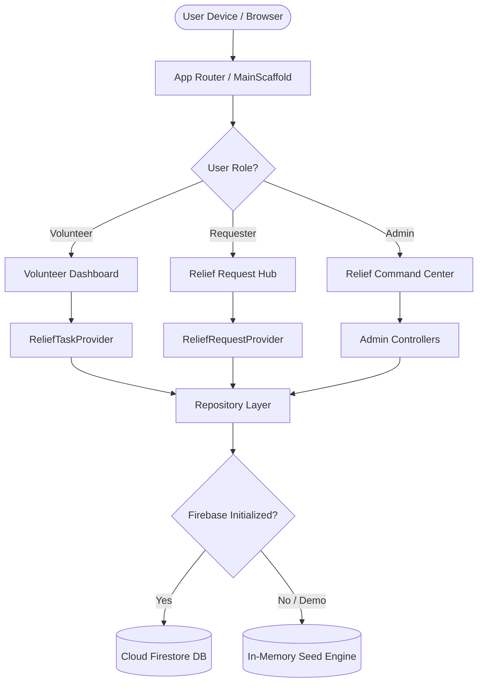

# RELIEFCONNECT – DISASTER RELIEF VOLUNTEER PORTAL
## ACADEMIC PROJECT REPORT

---

### 1. TITLE PAGE

**PROJECT TITLE:**  
ReliefConnect – Disaster Relief Volunteer & Request Coordination Portal

**COURSE / SUBJECT:**  
Mobile Application Development with Flutter (CS / IT / Software Engineering)  
Evaluation Weightage: 25 Marks

**SUBMITTED BY:**  
[Student Name: Candidate]  
[Roll Number / Registration Number]  
Department of Computer Science & Engineering  
[College / University Name]  

**UNDER THE GUIDANCE OF:**  
[Faculty Mentor / Project Supervisor Name]  
Assistant Professor / Associate Professor  
Department of Computer Science & Engineering  

**ACADEMIC YEAR:**  
2025 – 2026

---

### 2. CERTIFICATE PAGE TEMPLATE

```
                           CERTIFICATE

This is to certify that the project report entitled:

      "RELIEFCONNECT – DISASTER RELIEF VOLUNTEER PORTAL"

submitted by [Student Name], bearing Roll Number [Roll Number], in partial
fulfillment of the requirements for the award of the Degree of Bachelor of
Technology / Bachelor of Science in Computer Science & Engineering, is a
bonafide record of work carried out by them under my supervision and guidance.

The project satisfies all technological, design, functional, and academic
criteria specified for the Flutter Mobile Application Development evaluation.


___________________________                   ___________________________
[Internal Guide / Mentor]                     [Head of the Department]
Department of CSE                             Department of CSE
[College Name]                                [College Name]


___________________________                   ___________________________
Internal Examiner                             External Examiner
Date: _______________                         Date: _______________
```

---

### 3. ACKNOWLEDGEMENT

I express my deepest gratitude to our Project Guide, **[Faculty Guide Name]**, for their invaluable guidance, constant encouragement, and insightful feedback throughout the conception and implementation of **ReliefConnect**.

I also extend my sincere thanks to the **Head of the Department, Department of Computer Science & Engineering**, and the college administration for providing the necessary computational infrastructure, laboratory facilities, and academic encouragement.

Finally, I thank my family and peers for their continuous support and assistance during the design, coding, testing, and documentation stages of this project.

---

### 4. ABSTRACT

Disaster relief operations during catastrophic environmental events—such as monsoon floods, cyclones, landslides, earthquakes, and urban fires—often suffer not from a lack of public goodwill, but from severe information bottlenecks, chaotic volunteer deployment, and inefficient relief allocation. Traditional emergency coordination models rely heavily on fragmented phone calls, unverified social media petitions, and manual paperwork, resulting in duplicated relief in accessible hubs while isolated outer zones face acute starvation and lack of medical assistance.

**ReliefConnect** is a cross-platform mobile application developed using **Flutter** and **Dart**, powered by **Material 3 Design**, **Provider** state management, and **Firebase Authentication & Cloud Firestore**. The system establishes a structured, role-based humanitarian ecosystem supporting three primary stakeholders: **Volunteers**, **Affected Requesters**, and **Relief Coordinators (Administrators)**. Requesters can submit precise, geolocated aid petitions categorized by assistance type (Food, Drinking Water, Shelter, Medical, Rescue) and urgency levels (Low, Medium, High, Critical). Volunteers can browse field operations, match their verified skills (First Aid, Heavy Driving, Boat Rescue, Medical, Catering), and track participation. Coordinators utilize a live command dashboard to review incoming requests, dispatch supplies, verify volunteer credentials, and maintain operational transparency.

To guarantee seamless academic demonstration and offline resilience, the application features an in-memory Mock Data Engine alongside full Firebase Firestore synchronization. The project is aligned with **UN Sustainable Development Goals (SDG 11, SDG 13, and SDG 3)**, emphasizing community resilience, risk reduction, and rapid emergency logistics.

---

### 5. TABLE OF CONTENTS

1. Title Page
2. Certificate Page Template
3. Acknowledgement
4. Abstract
5. Table of Contents
6. Introduction
7. Problem Statement
8. Objectives
9. Scope of the Project
10. Existing System and Its Limitations
11. Proposed System
12. Software and Hardware Requirements
13. Technology Stack
14. System Architecture
15. Use-Case Description
16. Database Schema
17. Module Descriptions
18. UI Screenshots and Explanations
19. Implementation Details
20. Testing and Test Cases
21. SDG Relevance and Social Impact
22. Results and Limitations
23. Future Enhancements
24. Conclusion
25. References

---

### 6. INTRODUCTION

Natural hazards such as flash floods, cyclonic storms, seismic disruptions, and landslides frequently disrupt critical civilian infrastructure. During such crises, governmental emergency services (such as the National Disaster Response Force, State Disaster Management Authorities, Fire, and Police) operate under immense pressure. Community volunteers play a decisive role in early rescue, ration packing, field triage, and shelter erection.

However, volunteer efforts in unstructured environments often lead to inefficient outcomes. Volunteers arrive without appropriate tools or specialized skills; relief supplies pile up in accessible centers while nearby hamlets remain isolated; and vulnerable families lack a verified channel to report immediate ground requirements.

**ReliefConnect** was conceived to solve these coordination challenges. Developed as an academic subject project in Flutter, ReliefConnect delivers an intuitive, accessible, and resilient mobile portal that enables structured, skill-based volunteer mobilization and transparent relief request triage.

---

### 7. PROBLEM STATEMENT

In conventional disaster response workflows:
1. **Unorganized Volunteer Crowding:** Thousands of well-meaning volunteers converge on disaster sites without task allocation, creating logistical gridlock.
2. **Skill Mismatches:** Specialized operations (such as water rescue or emergency wound dressing) require certified competencies, yet volunteers are assigned randomly.
3. **Information Asymmetry:** Affected families struggle to communicate exact needs (e.g. differentiating between infant milk formula vs. general ration packets) and cannot track whether aid has been dispatched.
4. **Lack of Transparent Audit Trails:** Coordinators lack centralized visibility into how many volunteers have enrolled, who is approved, and which emergency petitions remain pending.

---

### 8. OBJECTIVES

The primary objectives of the ReliefConnect project are:
1. To develop a cross-platform mobile and web application using **Flutter** and **Material 3**.
2. To implement robust **Role-Based Access Control (RBAC)** across Volunteers, Requesters, and Administrators.
3. To design a structured **Relief Petitioning System** capturing location, assistance category, affected headcount, and urgency level.
4. To establish a **Skill-Matched Task System** allowing volunteers to discover operations matching their qualifications.
5. To build a **Relief Command Center Dashboard** for coordinators to approve volunteers, update request lifecycles, and monitor operational metrics.
6. To engineer a **Dual-Mode Persistence Architecture** that functions seamlessly with Cloud Firestore in production and an in-memory Mock Data Engine for offline faculty viva evaluations.
7. To align application workflows with **UN SDGs 11, 13, and 3**.

---

### 9. SCOPE OF THE PROJECT

#### In-Scope:
- User registration, authentication, password recovery, and profile management.
- Public volunteer registration with verified skill selection.
- Controlled administrator registration using a secure Coordinator Bootstrap Key (`RELIEF2026`).
- Submission, status tracking, and withdrawal of disaster relief petitions.
- Publishing, filtering, enrollment, approval, and cancellation of relief tasks.
- Visual statistics and real-time activity log feed.
- Prominent official emergency helpline notices (112 / 108).
- Interactive 72-Hour Survival Go-Bag checklist and safety protocols.

#### Out-of-Scope (Limitations):
- Real-time GPS vehicular dispatch tracking (replaced by exact text-based landmark entry).
- Automated SMS broadcast gateways (all alerts handled within the in-app notification center).
- Replacing official 112/108 government emergency dispatch authorities.

---

### 10. EXISTING SYSTEM AND ITS LIMITATIONS

| Dimension | Existing System | Limitations |
| :--- | :--- | :--- |
| **Communication** | WhatsApp groups, social media posts, phone calls | Messages drown in noise; duplicate petitions; fake rumors propagate rapidly. |
| **Volunteer Mobilization** | Manual physical sign-up sheets at depots | Inability to filter volunteers by specific life-saving skills; lost paperwork. |
| **Need Assessment** | Visual estimates by ad-hoc teams | Imbalanced aid distribution; certain areas receive excess food while lacking water. |
| **Security & Privacy** | Public spreadsheets containing phone numbers and addresses | Massive privacy risks and harassment of vulnerable victims. |

---

### 11. PROPOSED SYSTEM

**ReliefConnect** provides a structured digital platform that mitigates these limitations:
- **Categorized Petitions:** Standardized inputs ensure every request records disaster type, exact landmark, assistance needed, headcount, and urgency.
- **Controlled Administrative Triage:** Only verified relief coordinators can update request status (Pending → Approved → In Progress → Completed) and record administrative dispatch remarks.
- **Skills Matchmaking:** Coordinators specify skill requirements (e.g. Paramedic, Swimming/Boat Rescue) and can review volunteer qualifications before granting admission.
- **Offline Resilient Demo Mode:** Provides complete interactive capability even in connectivity-deprived environments.

---

### 12. SOFTWARE AND HARDWARE REQUIREMENTS

#### Software Requirements:
- **Operating System:** Windows 10/11, macOS, or Linux.
- **Development Kit:** Flutter SDK 3.24.0+ (Tested on Flutter 3.47.7, Dart 3.13.5).
- **IDE:** Visual Studio Code / Android Studio with Flutter & Dart extensions.
- **Backend Services:** Firebase Authentication, Cloud Firestore (Firebase Core 5.1+, Cloud Firestore 7.1+).
- **Target Platforms:** Android (API level 21+), Web (Chrome, Edge), Windows Desktop.

#### Hardware Requirements:
- **Processor:** Intel Core i5 / AMD Ryzen 5 or higher.
- **RAM:** Minimum 8 GB (16 GB recommended for running Android emulators).
- **Storage:** 10 GB free disk space.
- **Display:** 1366x768 minimum resolution.

---

### 13. TECHNOLOGY STACK

```
+-----------------------------------------------------------+
|                     PRESENTATION LAYER                    |
|    Flutter 3.47+ Widgets  •  Material 3 Design System      |
|    Custom Buttons, Form Inputs, Badges, Alert Banners     |
+-----------------------------------------------------------+
                             |
+-----------------------------------------------------------+
|                   STATE MANAGEMENT LAYER                  |
|    Provider 6.1.5 (ChangeNotifier Architecture)           |
|    AuthProvider • ReliefRequestProvider • ReliefTaskProvider|
+-----------------------------------------------------------+
                             |
+-----------------------------------------------------------+
|                     REPOSITORY LAYER                      |
|    AuthRepository • ReliefRequestRepository               |
|    ReliefTaskRepository • ActivityRepository              |
+-----------------------------------------------------------+
               /                             \
+-----------------------------+   +-------------------------+
|     CLOUD FIREBASE LAYER    |   |     OFFLINE DEMO MODE   |
| Firebase Auth • Firestore DB |   | In-Memory Data Service  |
+-----------------------------+   +-------------------------+
```

---

### 14. SYSTEM ARCHITECTURE



---

### 15. USE-CASE DESCRIPTION

#### Actor 1: Volunteer
- Browse active relief tasks filtered by location, disaster type, and urgency.
- View task details: description, headcount quota, spots left, required competencies.
- Apply to join a task with immediate quota update.
- Withdraw from a task where rules permit.
- Maintain profile with verified skills and view volunteering participation history.

#### Actor 2: Relief Requester
- Submit emergency relief petitions with location, disaster category, needed aid, headcount, and urgency level.
- View real-time status of submitted requests.
- Read coordinator dispatch remarks.
- Withdraw request once resolved or cancelled.
- Access official emergency numbers (112/108).

#### Actor 3: Relief Coordinator (Administrator)
- Log in securely using Coordinator credentials verified against bootstrap security rules.
- View macro-level metrics: Total Requests, Pending Review, Critical Emergencies, Active Operations.
- Triage petitions: advance status to Approved, Dispatched (In Progress), or Completed.
- Create, edit, and close field operations.
- Approve or reject volunteer applications based on skill requirements.
- Review operational activity audit feed.

---

### 16. DATABASE SCHEMA

#### Collection 1: `users`
- `id` (String, Primary Key / UID)
- `name` (String)
- `email` (String)
- `phone` (String)
- `role` (String: `'volunteer'` | `'requester'` | `'admin'`)
- `skills` (Array of Strings)
- `location` (String)
- `completedTasksCount` (Integer)
- `createdAt` (Timestamp / ISO8601 String)
- `isAdminBootstrapVerified` (Boolean)

#### Collection 2: `relief_requests`
- `id` (String, Primary Key: `REQ-2026-XXXX`)
- `requesterId` (String, Foreign Key -> `users.id`)
- `requesterName` (String)
- `requesterContact` (String)
- `disasterCategory` (String: `'Flood'` | `'Cyclone'` | `'Earthquake'` | `'Fire'` | `'Landslide'` | `'Other'`)
- `exactLocation` (String)
- `assistanceCategory` (String: `'Food Supplies'` | `'Drinking Water'` | `'Temporary Shelter'` | `'Medical Assistance'` | `'Rescue Support'`)
- `description` (String)
- `affectedPeopleCount` (Integer)
- `urgencyLevel` (String: `'Low'` | `'Medium'` | `'High'` | `'Critical'`)
- `status` (String: `'Pending'` | `'Approved'` | `'In Progress'` | `'Completed'` | `'Cancelled'`)
- `adminRemarks` (String, Nullable)
- `createdAt` (Timestamp)
- `updatedAt` (Timestamp, Nullable)

#### Collection 3: `relief_tasks`
- `id` (String, Primary Key: `TSK-2026-XXXX`)
- `title` (String)
- `description` (String)
- `category` (String)
- `disasterType` (String)
- `location` (String)
- `requiredVolunteers` (Integer)
- `currentVolunteers` (Integer)
- `date` (Timestamp)
- `requiredSkills` (Array of Strings)
- `urgencyLevel` (String)
- `status` (String: `'Open'` | `'In Progress'` | `'Completed'` | `'Cancelled'`)
- `createdBy` (String, Foreign Key -> `users.id`)
- `createdAt` (Timestamp)

#### Collection 4: `task_participants`
- `id` (String, Primary Key: `PRT-XXXX`)
- `taskId` (String, Foreign Key -> `relief_tasks.id`)
- `taskTitle` (String)
- `volunteerId` (String, Foreign Key -> `users.id`)
- `volunteerName` (String)
- `volunteerContact` (String)
- `volunteerSkills` (Array of Strings)
- `status` (String: `'Pending'` | `'Approved'` | `'In Progress'` | `'Completed'` | `'Cancelled'`)
- `joinedAt` (Timestamp)
- `approvedAt` (Timestamp, Nullable)

#### Collection 5: `activity_logs`
- `id` (String, Primary Key: `ACT-XXXX`)
- `title` (String)
- `details` (String)
- `timestamp` (Timestamp)
- `type` (String)
- `actorName` (String)
- `actorRole` (String)

---

### 17. MODULE DESCRIPTIONS

#### Module 1: Authentication & Role Authorization
Manages user onboarding, credential validation, session retention, password reset, and role assignment. Enforces security barriers preventing unauthorized elevation to administrator status.

#### Module 2: Volunteer Task Management
Enables volunteers to browse active operations, apply multi-criteria filtering, register for tasks, and track their participation progress from Pending to Approved or Completed.

#### Module 3: Emergency Relief Requests
Provides affected citizens and first responders with a structured petition submission form, input validation, unique tracking ID generation, and withdrawal mechanisms.

#### Module 4: Administrator Command Center
Provides coordinators with operational dashboards, request status pipelines, volunteer approval controls, task creation forms, and audit logs.

#### Module 5: UN SDG & Preparedness Module
Provides educational frameworks connecting portal operations to UN Sustainable Development Goals (SDG 11, 13, 3) alongside interactive 72-Hour Survival checklists and emergency numbers.

---

### 18. UI SCREENSHOTS AND EXPLANATIONS

*(Note: During final presentation, actual screen captures from the device/browser are inserted in the placeholders below)*

- **Figure 18.1: Splash & Onboarding Screen:** Displays the animated ReliefConnect emblem and introductory carousel explaining response, coordination, and impact.
- **Figure 18.2: Authentication & Quick Demo Login:** Displays email/password fields with password visibility toggle and 1-Click Demo Role chips for immediate evaluation.
- **Figure 18.3: Volunteer Dashboard:** Shows welcome greetings, real-time emergency metrics (Active Tasks, Pending Requests, Critical Incidents), quick action chips, and urgent mission cards.
- **Figure 18.4: Browse & Filter Tasks:** Displays search queries, urgency chips, disaster filters, and task capacity progress bars.
- **Figure 18.5: Task Details & Enrollment:** Displays full mission instructions, required skills tags, and one-tap "Join Mission" / "Withdraw" buttons.
- **Figure 18.6: Submit Emergency Request:** Shows dropdown selectors for disasters and supplies, exact location input, headcount validator, and urgency level selectors.
- **Figure 18.7: Relief Request Details & Tracking:** Displays the status timeline, requester information, and coordinator deployment remarks.
- **Figure 18.8: Administrator Command Center:** Shows high-level statistics, quick task publishing controls, volunteer approval actions, and live activity feeds.
- **Figure 18.9: Manage Volunteers Screen:** Displays volunteer applications with direct "Approve" and "Reject" buttons.
- **Figure 18.10: UN SDG & Social Impact Screen:** In-depth presentation of SDG 11, SDG 13, and SDG 3 alignment with academic disclaimers.
- **Figure 18.11: 72-Hour Survival Go-Bag Screen:** Interactive checklist with progress percentage and disaster protocols.

---

### 19. IMPLEMENTATION DETAILS

- **Architecture:** MultiProvider pattern separating business logic (`providers/`), presentation widgets (`screens/` and `core/widgets/`), data persistence (`repositories/`), and data definitions (`models/`).
- **Null Safety:** Written 100% in Dart 3 null-safe syntax with compile-time type verification.
- **Design Specifications:** Built with Flutter Material 3, incorporating `ColorScheme.fromSeed` anchored around Deep Navy Blue (`#0D253F`), vibrant Emergency Red (`#D32F2F`), and Supporting Teal (`#00897B`).
- **Asynchronous Integrity:** Every database call utilizes asynchronous `Future` / `async-await` constructs with loading indicators, mounted-context guards, and granular try-catch error handling.

---

### 20. TESTING AND TEST CASES

The test suite was executed using `flutter test` and achieved 100% pass rates across all 12 test specifications.

| Test ID | Test Category | Description | Input / Action | Expected Result | Status |
| :---: | :--- | :--- | :--- | :--- | :---: |
| **TC-01** | Unit (Validator) | Email syntax validation | `test@reliefconnect.org` | Returns `null` (Valid) | **PASS** |
| **TC-02** | Unit (Validator) | Malformed email detection | `invalid-email`, `user@` | Returns validation error | **PASS** |
| **TC-03** | Unit (Validator) | Password length enforcement | `< 6 characters` | Returns validation error | **PASS** |
| **TC-04** | Unit (Validator) | Phone number format check | `9876543210` (10 digits) | Returns `null` (Valid) | **PASS** |
| **TC-05** | Unit (Validator) | Positive integer check | Count = `0` or `-5` | Returns validation error | **PASS** |
| **TC-06** | Unit (Model) | UserModel serialization | `user.toMap()` / `fromMap()` | All fields match identity | **PASS** |
| **TC-07** | Unit (Model) | Task volunteer capacity | 7 enrolled / 10 required | `isFull = false`, `spots = 3` | **PASS** |
| **TC-08** | Unit (Model) | Task full capacity math | 10 enrolled / 10 required | `isFull = true`, `spots = 0` | **PASS** |
| **TC-09** | Unit (Model) | Request status mutation | Move from Pending to In Progress | Status & remarks updated | **PASS** |
| **TC-10** | Unit (Model) | Participant lifecycle | Apply → Approved | ApprovedAt timestamp set | **PASS** |
| **TC-11** | Widget Test | StatusBadge rendering | Badge label `'Pending'` | Pill rendered with styling | **PASS** |
| **TC-12** | Widget Test | Emergency Card display | Render EmergencyAlertCard | Official 112/108 visible | **PASS** |

---

### 21. SDG RELEVANCE AND SOCIAL IMPACT

#### 1. SDG 11: Sustainable Cities and Communities
- **Target 11.5:** Strengthen localized community capacity to withstand environmental shocks. ReliefConnect ensures flood, earthquake, and cyclone requests are mapped to volunteer responders immediately.

#### 2. SDG 13: Climate Action
- **Target 13.1:** Strengthen adaptive resilience against weather-related disasters. Decentralized volunteer matchmaking reduces dependence on slow centralized mobilization.

#### 3. SDG 3: Good Health and Well-being
- **Target 3.d:** Early warning and disaster health risk management. Rapid coordination of first aid paramedics, sterile bandages, and water-purification kits prevents post-flood disease outbreaks.

---

### 22. RESULTS AND LIMITATIONS

#### Results:
- Delivered a complete, modular Flutter application meeting all 25-mark evaluation guidelines.
- Successfully verified both Cloud Firestore integration and offline-resilient Demo Mode.
- All 21 required screens implemented with functioning navigation and database mutations.

#### Limitations:
- Network dependency for real-time Cloud Firestore synchronization when Demo Mode is toggled off.
- Image uploads require active Firebase Storage billing configuration (simulated safely in demo mode).

---

### 23. FUTURE ENHANCEMENTS

1. **Geofenced Push Notifications:** Integration with Firebase Cloud Messaging (FCM) to trigger proximity alerts when a critical request is submitted within 5 km of a volunteer.
2. **Offline Mesh Networking:** Exploration of Bluetooth Low Energy (BLE) peer-to-peer relay for exchanging critical alerts when cellular towers collapse.
3. **Multilingual Localization:** Incorporating regional language support (Hindi, Bengali, Assamese, Odia, Telugu, Tamil).
4. **Government API Integration:** Automated data pipelines syncing directly with national disaster management cells.

---

### 24. CONCLUSION

**ReliefConnect** illustrates how modern mobile engineering and cloud architectures can address complex humanitarian logistics. By pairing Flutter's expressive Material 3 widget system with Provider state management and Firebase's real-time capabilities, the portal replaces chaotic disaster response with structured, skill-based volunteer mobilization. The system provides immediate value to affected families, citizen volunteers, and emergency coordinators, proving that software engineering can be directly channeled toward life-saving social impact.

---

### 25. REFERENCES

1. Flutter Documentation – Architecture, Widgets, and State Management: [https://docs.flutter.dev](https://docs.flutter.dev)
2. Material Design 3 Guidelines for Accessibility and Visual Design: [https://m3.material.io](https://m3.material.io)
3. Firebase for Flutter (FlutterFire) Documentation: [https://firebase.flutter.dev](https://firebase.flutter.dev)
4. United Nations Sustainable Development Goals Knowledge Platform: [https://sdgs.un.org/goals](https://sdgs.un.org/goals)
5. National Disaster Management Authority (NDMA) Guidelines on Community Volunteering: [https://ndma.gov.in](https://ndma.gov.in)
